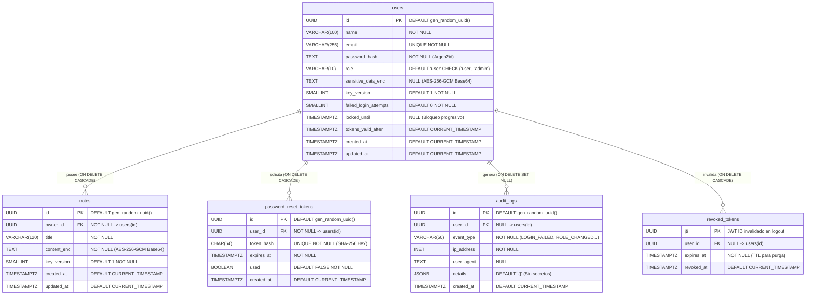
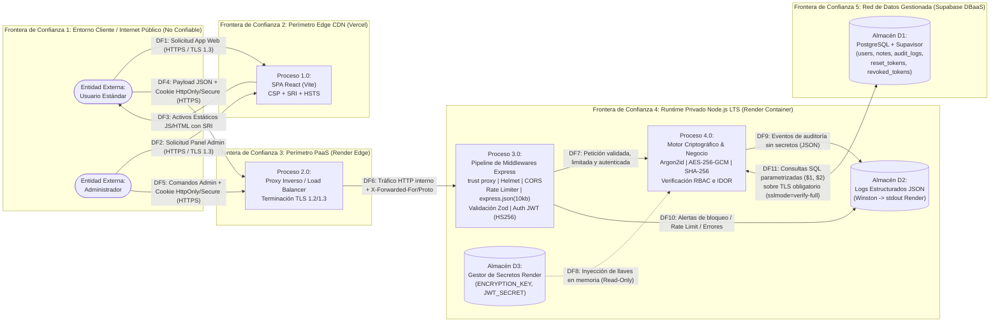

# Fase 1: Diseño Arquitectónico, Flujos de Autenticación y Modelo de Amenazas (OWASP A06:2025)
**Proyecto:** SecureVault — Sistema Seguro en Node.js (OWASP Top 10:2025)  
**Stack Arquitectónico:** React/Vite (Vercel) + Node.js LTS/Express (Render) + PostgreSQL (Supabase)

---

## 1. Modelo de Datos Relacional (Diagrama ER)

El esquema relacional implementa identificadores `UUID` v4 generados criptográficamente (`gen_random_uuid()`), integridad referencial estricta, soporte de rotación de llaves (`key_version`), revocación global e individual de tokens (`tokens_valid_after` y `revoked_tokens`) y bitácora forense (`audit_logs`).



### Justificación de Seguridad del Esquema SQL (`database/schema.sql`)
* **Mitigación de IDOR y enumeración de recursos (OWASP A01):** Todas las llaves primarias utilizan `UUID` v4 generados con `gen_random_uuid()` en lugar de enteros secuenciales predecibles. La clave foránea obligatoria `owner_id NOT NULL` en `notes` y su índice compuesto `idx_notes_owner_id` garantizan la verificación de propiedad en cada operación CRUD.
* **Defensa en profundidad contra escalada de privilegios (OWASP A01 / RF-03):** La columna `role` en `users` posee `DEFAULT 'user'` y `CHECK (role IN ('user', 'admin'))`, asegurando privilegio mínimo a nivel de motor de base de datos.
* **Protección ante robo de base de datos y fugas de credenciales (OWASP A04):** El esquema valida mediante expresiones regulares (`CHECK`) que `password_hash` solo acepte cadenas con prefijo `$argon2id$` o `$2b$`, que `token_hash` sea estrictamente un hash SHA-256 de 64 caracteres hexadecimales, y que las notas y datos sensibles residan cifrados (`content_enc`, `sensitive_data_enc`) acompañados de `key_version` para rotación de llaves AES-256-GCM.
* **Resistencia contra fuerza bruta y secuestro de sesión (OWASP A07):** Las columnas `failed_login_attempts`, `locked_until` y `tokens_valid_after` en `users`, junto con la tabla `revoked_tokens` (`jti`), garantizan el bloqueo progresivo persistente y la invalidación inmediata de sesiones tanto en logout individual (`RF-02`) como tras una recuperación de contraseña (`RF-06`).
* **Integridad forense y prevención de DoS por almacenamiento (OWASP A06 / A09):** La tabla `audit_logs` utiliza `ON DELETE SET NULL` en `user_id` para preservar la evidencia forense si un usuario es eliminado, emplea el tipo nativo `INET` para direcciones IP e incluye el evento `'CRYPTO_INTEGRITY_FAILURE'`.

---

## 2. Flujo de Autenticación, Autorización (RBAC) y Recuperación de Contraseña

### 2.1. Diagrama de Secuencia

```mermaid
sequenceDiagram
    autonumber
    actor U as Usuario / Navegador
    participant V as Frontend React (Vercel)
    participant R as API Express (Render)
    participant DB as PostgreSQL (Supabase)

    rect rgb(235, 245, 255)
        Note over U,DB: 1. Registro de Usuario (RF-01 / OWASP A04, A05)
        U->>V: Completa formulario (nombre, email, password, dato sensible)
        V->>R: POST /api/auth/register (HTTPS)
        R->>R: Valida esquema estricto con Zod (complejidad password 12-72 chars)
        R->>R: Hash Argon2id(password) + Cifrado AES-256-GCM(dato sensible)
        R->>DB: INSERT INTO users (role='user') + INSERT audit_logs ('USER_REGISTERED')
        DB-->>R: Confirmación UUID
        R-->>V: 201 Created { message: "Registro exitoso" }
    end

    rect rgb(255, 245, 235)
        Note over U,DB: 2. Inicio de Sesión y Protección Fuerza Bruta (RF-02 / OWASP A07, A09)
        U->>V: Ingresa credenciales
        V->>R: POST /api/auth/login (credentials: 'include')
        R->>R: Verifica Rate Limiter por IP (máx. 5 req / 15 min)
        alt Supera límite de peticiones por IP
            R->>DB: INSERT audit_logs ('LOGIN_FAILED', reason: 'rate_limit')
            R-->>V: 429 Too Many Requests { error: "Demasiados intentos, espere." }
        else Dentro del límite de tasa
            R->>DB: SELECT id, password_hash, role, failed_login_attempts, locked_until FROM users WHERE email = $1
            alt Cuenta bloqueada (locked_until > NOW()) o Password Argon2id inválido
                R->>DB: UPDATE users SET failed_login_attempts + 1 (y locked_until si >= 5)
                R->>DB: INSERT audit_logs ('LOGIN_FAILED' / 'ACCOUNT_LOCKED')
                R-->>V: 401 Unauthorized { error: "Credenciales inválidas" }
            else Credenciales válidas y cuenta activa
                R->>DB: UPDATE users SET failed_login_attempts = 0, locked_until = NULL
                R->>R: Genera jti (UUID v4) y firma JWT (alg: 'HS256', exp: 30m, sub: user.id, role)
                R->>DB: INSERT audit_logs ('LOGIN_SUCCESS')
                R-->>V: 200 OK + Set-Cookie: sv_token=JWT; HttpOnly; Secure; SameSite=Strict; Max-Age=1800
            end
        end
    end

    rect rgb(235, 255, 240)
        Note over U,DB: 3. Acceso a Recurso Protegido y Verificación IDOR (RF-04 / OWASP A01, A08)
        U->>V: Solicita ver nota privada (:id)
        V->>R: GET /api/notes/:id (Cookie: sv_token)
        R->>R: Verifica firma JWT con algoritmo fijo ['HS256'] y expiración
        R->>DB: Verifica jti no esté en revoked_tokens y iat >= user.tokens_valid_after
        alt Token revocado o inválido
            R-->>V: 401 Unauthorized { error: "Sesión inválida o expirada" }
        else Token activo
            R->>DB: SELECT id, owner_id, title, content_enc, key_version FROM notes WHERE id = $1
            alt No existe la nota
                R-->>V: 404 Not Found { error: "Nota no encontrada" }
            else Existe pero owner_id != req.user.sub (Intento IDOR detectado)
                R->>DB: INSERT audit_logs ('ACCESS_DENIED', target_note_id)
                R-->>V: 403 Forbidden { error: "Acceso denegado al recurso" }
            else Propiedad verificada (owner_id == req.user.sub)
                R->>R: Descifra content_enc con AES-256-GCM (verifica AuthTag 16B)
                R-->>V: 200 OK { id, title, content }
            end
        end
    end

    rect rgb(250, 235, 255)
        Note over U,DB: 4. Cierre de Sesión e Invalidación Server-Side (RF-02)
        U->>V: Pulsa "Cerrar Sesión"
        V->>R: POST /api/auth/logout (Cookie: sv_token)
        R->>R: Extrae jti y exp del JWT verificado
        R->>DB: INSERT INTO revoked_tokens (jti, user_id, expires_at) + INSERT audit_logs ('LOGOUT')
        R-->>V: 200 OK + Clear-Cookie: sv_token (Max-Age=0)
    end
```

### 2.2. Matriz de Control de Acceso Basado en Roles (RBAC) e IDOR

Política base (OWASP A01): **Denegar por defecto**. Todo endpoint no listado como público exige un JWT válido en cookie `HttpOnly`, con verificación explícita del algoritmo `algorithms: ['HS256']` (OWASP A08), comprobación contra `revoked_tokens` y verificación de `iat >= tokens_valid_after`.

| Endpoint | Método | Rol permitido | Validación de propiedad (IDOR) | Respuesta si falla |
| :--- | :---: | :---: | :--- | :--- |
| `/api/health` | `GET` | Público | N/A (No expone versiones, motor ni variables internas - RF-08). | `503 Service Unavailable` `{ "status": "error" }` |
| `/api/auth/register` | `POST` | Público | N/A (Fuerza `role = 'user'` en servidor ignorando cualquier campo `role` del body). | `400 Bad Request` (Validación Zod) / `429 Too Many Requests` |
| `/api/auth/login` | `POST` | Público | N/A (Verifica credenciales y estado `locked_until`). | `401 Unauthorized` `{ "error": "Credenciales inválidas" }` / `429` |
| `/api/auth/logout` | `POST` | `user`, `admin` | Valida que el `jti` del token pertenezca a la sesión activa del solicitante. | `401 Unauthorized` `{ "error": "No autenticado" }` |
| `/api/auth/forgot-password` | `POST` | Público | N/A (Nunca revela si el correo existe; responde siempre con mensaje constante). | `200 OK` (Respuesta constante anti-enumeración) / `429` |
| `/api/auth/reset-password` | `POST` | Público | Valida hash SHA-256 del token (`used = FALSE` y `expires_at > NOW()`). | `400 Bad Request` `{ "error": "Token inválido o expirado" }` |
| `/api/profile` | `GET` | `user`, `admin` | Consulta filtrada exclusivamente por `WHERE id = req.user.sub` (Dato sensible enmascarado `***-***-1234` - RF-05). | `401 Unauthorized` |
| `/api/profile/sensitive` | `PUT` | `user`, `admin` | Actualiza `sensitive_data_enc` exclusivamente donde `id = req.user.sub`. | `400 Bad Request` / `401 Unauthorized` |
| `/api/notes` | `GET` | `user`, `admin` | `SELECT ... FROM notes WHERE owner_id = req.user.sub` (Un `admin` tampoco puede listar notas ajenas - RF-04). | `401 Unauthorized` |
| `/api/notes` | `POST` | `user`, `admin` | Asigna `owner_id = req.user.sub` desde el JWT verificado. Valida cuota máxima de 50 notas (A06). | `400 Bad Request` / `401 Unauthorized` / `403 Forbidden` |
| `/api/notes/:id` | `GET`, `PUT`, `DELETE` | `user`, `admin` | Verifica `note.owner_id === req.user.sub`. Si no existe devuelve `404`; si pertenece a otro usuario registra `ACCESS_DENIED` en `audit_logs` y devuelve `403`. | `403 Forbidden` (IDOR bloqueado y auditado) / `404 Not Found` |
| `/api/admin/users` | `GET` | Solo `admin` | Middleware `requireRole('admin')` verifica el rol en BD/JWT. Lista usuarios sin hashes ni datos cifrados (RF-07). | `401 Unauthorized` / `403 Forbidden` (Si `role === 'user'`) |
| `/api/admin/users/:id/role` | `PATCH` | Solo `admin` | `requireRole('admin')`. Impide auto-degradación del último admin. Actualiza `tokens_valid_after` y registra `ROLE_CHANGED`. | `403 Forbidden` / `400 Bad Request` |
| `/api/admin/audit-logs` | `GET` | Solo `admin` | `requireRole('admin')`. Consulta paginada de `audit_logs` ordenada por `created_at DESC` (RF-07). | `401 Unauthorized` / `403 Forbidden` |

### 2.3. Flujo de Recuperación de Contraseña (RF-06 / OWASP A04, A07)

1. **Solicitud y respuesta anti-enumeración (`POST /api/auth/forgot-password`):** El endpoint aplica *rate limiting* (máx. 3 solicitudes/hora) y valida el formato con Zod. Tanto si el correo existe en `users` como si no, responde con `200 OK`: *"Si el correo está registrado, recibirá instrucciones de recuperación"*.
2. **Invalidación previa y generación con `crypto.randomBytes(32)`:** Si el usuario existe, se invalidan los tokens previos pendientes (`UPDATE password_reset_tokens SET used = TRUE WHERE user_id = $1 AND used = FALSE`) y se genera un token criptográfico de 32 bytes (256 bits de entropía): `const rawToken = crypto.randomBytes(32).toString('hex');`.
3. **Derivación del Hash SHA-256 y persistencia con expiración corta (15 min):** Se calcula `const tokenHash = crypto.createHash('sha256').update(rawToken).digest('hex');` y se almacena únicamente `token_hash` (`CHAR(64)`) en `password_reset_tokens` con `expires_at = NOW() + INTERVAL '15 minutes'` y `used = FALSE`. Se registra `PASSWORD_RESET_REQUESTED` en `audit_logs`.
4. **Entrega del token en claro:** El `rawToken` nunca se almacena en la BD; se entrega exclusivamente al canal del usuario. Si la BD es comprometida, los hashes SHA-256 de alta entropía no pueden revertirse.
5. **Validación atómica y consumo de un solo uso (`POST /api/auth/reset-password`):** Al recibir el `rawToken` y la nueva contraseña, el servidor recalcula `SHA-256(rawToken)` y ejecuta atómicamente: `UPDATE password_reset_tokens SET used = TRUE WHERE token_hash = $1 AND used = FALSE AND expires_at > CURRENT_TIMESTAMP RETURNING user_id;`.
6. **Recálculo de Argon2id e invalidación global de sesiones:** Se hashea la nueva contraseña con **Argon2id**, se actualiza `users.password_hash`, se reinicia `failed_login_attempts = 0`, `locked_until = NULL`, se actualiza `tokens_valid_after = CURRENT_TIMESTAMP` (invalidando instantáneamente cualquier JWT previo activo en otros dispositivos) y se registra `PASSWORD_RESET_COMPLETED` en `audit_logs`.

---

## 3. Diagrama de Flujo de Datos (DFD) y Límites de Negocio (OWASP A06:2025)

### 3.1. Diagrama de Flujo de Datos con Fronteras de Confianza



### 3.2. Tabla de Límites de Negocio y Controles Anti-Abuso (OWASP A06:2025)

| Recurso / Acción | Límite definido | Justificación de seguridad | Código HTTP al exceder |
| :--- | :--- | :--- | :---: |
| **Tamaño máximo de payload JSON global** (`express.json`) | **10 KB** (`limit: '10kb'`) | Previene ataques de agotamiento de memoria RAM (512 MB en Render Free) y bloqueo del *Event Loop* de Node.js mediante cuerpos JSON masivos. | `413 Payload Too Large` |
| **Cuota máxima de notas por usuario** (`POST /api/notes`) | **50 notas activas** por `owner_id` | Mitiga el abuso de almacenamiento (*Storage Exhaustion*) sobre el límite de 500 MB de Supabase Free por parte de cuentas automatizadas. | `403 Forbidden` |
| **Longitud de título y contenido de nota** (`RF-04`) | Título: **1 a 120 caracteres**<br/>Contenido en claro: **1 a 5,000 caracteres** | Acota el tiempo de CPU del cifrado `AES-256-GCM` por petición y evita que el texto cifrado resultante (`content_enc` en Base64) degrade PostgreSQL. | `400 Bad Request` |
| **Longitud de dato sensible de perfil** (`RF-05`) | **4 a 64 caracteres** | Restringe el campo (teléfono o documento) a un formato acotado antes de cifrarlo con AES-256-GCM y enmascararlo (`***-***-1234`). | `400 Bad Request` |
| **Longitud de contraseña en registro/cambio** (`RF-01`) | Mínimo **12 caracteres**, máximo **72 caracteres** (con mayúscula, minúscula, número y símbolo) | El mínimo de 12 caracteres garantiza entropía contra fuerza bruta; el tope de 72 caracteres impide ataques de denegación de servicio por cómputo excesivo (*CPU/Memory DoS*) en **Argon2id** (`19 MiB`). | `400 Bad Request` |
| **Intentos de inicio de sesión y bloqueo progresivo** (`RF-02`, `A07`) | **5 intentos fallidos cada 15 minutos** (por IP y por cuenta `failed_login_attempts`) | Mitiga ataques de fuerza bruta y *Credential Stuffing*. Al 5.º fallo consecutivo se bloquea la IP y se establece `locked_until = NOW() + 15 min` en BD, disparando alerta en `audit_logs` (A09). | `429 Too Many Requests` |
| **Solicitudes de recuperación de contraseña** (`RF-06`) | **3 solicitudes cada 60 minutos** por IP/cuenta | Evita el inundamiento de la tabla `password_reset_tokens` y ataques de enumeración. | `429 Too Many Requests` |
| **Expiración y uso de token de recuperación** (`RF-06`) | **15 minutos de vida útil (TTL)** y **1 solo uso** (`used = TRUE`) | Reduce la ventana de exposición temporal del token aleatorio de 32 bytes e impide ataques de repetición (*Replay Attacks*). | `400 Bad Request` |
| **Tiempo de vida de sesión JWT** (`RF-02`) | **30 minutos** (`Max-Age=1800`) + revocación explícita por `jti` y `tokens_valid_after` | Limita la ventana de impacto en caso de robo de sesión y obliga a revalidar periódicamente el estado y rol activo del usuario. | `401 Unauthorized` |
| **Timeouts de base de datos y consultas** (`A10`) | `statement_timeout`: **5,000 ms**<br/>`connectionTimeoutMillis`: **3,000 ms** | Evita que consultas lentas o bloqueos en PostgreSQL agoten el pool de conexiones y dejen colgado el servidor Express (*Fail-Closed* - OWASP A10). | `503 Service Unavailable` |
| **Paginación en listado de notas y bitácora admin** (`RF-04`, `RF-07`) | Máximo **50 registros por página** (`LIMIT 50 OFFSET $1`) | Impide que una consulta sin límite descargue miles de registros en memoria y colapse el contenedor de Node.js. | `400 Bad Request` |

---

## 4. Modelo de Amenazas STRIDE y Casos de Abuso Prioritarios

### 4.1. Matriz STRIDE

| Categoría STRIDE | Componente afectado | Caso de abuso concreto | Mitigación en SecureVault | Categoría OWASP 2025 relacionada |
| :--- | :--- | :--- | :--- | :--- |
| **S — Spoofing** *(Suplantación de identidad)* | Proceso 3.0 / 4.0: Endpoints `/api/auth/login` y validación de sesión JWT en Express. | Un atacante realiza un ataque de fuerza bruta o *Credential Stuffing* para adivinar la contraseña de un usuario, o intenta forjar un JWT alterando la cabecera a `"alg": "none"` o reutilizando un token cerrado tras el logout. | 1. Hash lento con sal **Argon2id** (`memoryCost: 19456`, `timeCost: 2`, `parallelism: 1`).<br/>2. `express-rate-limit` (máx. 5 intentos / 15 min) + bloqueo en BD (`locked_until`).<br/>3. `jwt.verify()` con algoritmo fijo `algorithms: ['HS256']`, cookie `HttpOnly; Secure; SameSite` y validación contra `revoked_tokens` y `tokens_valid_after`. | **A07:2025** Authentication Failures<br/>**A08:2025** Software or Data Integrity Failures |
| **T — Tampering** *(Manipulación de datos)* | Almacén D1: Tablas `notes` (`content_enc`) y `users` (`sensitive_data_enc`) en PostgreSQL; Peticiones API REST. | Un atacante con acceso de escritura a la BD altera bytes del texto cifrado de una nota o inyecta payloads `' OR 1=1 --` y `<script>` en el título/contenido para modificar registros o ejecutar XSS. | 1. Cifrado autenticado **AES-256-GCM** con IV único de 12 bytes y verificación estricta del **Authentication Tag de 16 bytes** con `decipher.setAuthTag()` antes de aceptar el texto descifrado.<br/>2. Consultas 100% parametrizadas (`$1, $2`) en `pg`, validación estricta con esquemas **Zod** y política **CSP** en `helmet` sin `unsafe-inline`. | **A04:2025** Cryptographic Failures<br/>**A05:2025** Injection (incluye XSS)<br/>**A08:2025** Software or Data Integrity Failures |
| **R — Repudiation** *(Repudio de acciones)* | Proceso 4.0 y Almacén D1/D2: Tabla `audit_logs` y flujo de salida `winston`. | Un usuario malicioso o un administrador modifica el rol de una cuenta, intenta acceder repetidamente a notas ajenas o realiza ataques de login y posteriormente niega haber ejecutado dichas acciones. | 1. Registro inmutable de eventos de seguridad (`LOGIN_FAILED`, `ACCOUNT_LOCKED`, `ROLE_CHANGED`, `ACCESS_DENIED`, `CRYPTO_INTEGRITY_FAILURE`) en la tabla `audit_logs` (con `ip_address INET`, `user_id` con `ON DELETE SET NULL`, `user_agent` y `TIMESTAMPTZ`).<br/>2. Emisión simultánea de logs estructurados en formato **JSON** vía `winston` hacia `stdout` de Render + alerta ante 5 fallos consecutivos. | **A09:2025** Security Logging and Alerting Failures |
| **I — Information Disclosure** *(Divulgación de información)* | Almacén D1 (Supabase), Almacén D3 (Secretos) y Respuestas HTTP de Express (`/api/notes/:id`, `/api/health`). | 1. Un usuario autenticado A cambia el UUID en `GET /api/notes/:id` para leer una nota del usuario B (IDOR).<br/>2. Fuga de la BD por compromiso de credenciales.<br/>3. Exposición de *stack traces* o versiones al forzar un error interno. | 1. Verificación explícita de `note.owner_id === req.user.sub` en cada operación sobre notas.<br/>2. Datos sensibles cifrados en reposo con **AES-256-GCM**, tokens de recuperación hasheados con **SHA-256**, llaves en el gestor de secretos de Render y conexión a Supabase con TLS forzado (`sslmode=verify-full`).<br/>3. `app.disable('x-powered-by')`, `NODE_ENV=production` y manejador global de errores *fail-closed* con respuestas genéricas. | **A01:2025** Broken Access Control<br/>**A02:2025** Security Misconfiguration<br/>**A04:2025** Cryptographic Failures<br/>**A10:2025** Mishandling of Exceptional Conditions |
| **D — Denial of Service** *(Denegación de servicio)* | Proceso 3.0 / 4.0 (Contenedor Node.js en Render) y Almacén D1 (Supabase Free). | Un atacante envía payloads JSON de varios megabytes, contraseñas de miles de caracteres para saturar Argon2id, o crea miles de notas para agotar los 512 MB de RAM de Render o los 500 MB de disco en Supabase. | 1. Límite global de payload en Express: `express.json({ limit: '10kb' })`.<br/>2. Esquema **Zod** que rechaza contraseñas `> 72` caracteres y notas `> 5,000` caracteres.<br/>3. Cuota en servidor de máximo **50 notas por usuario**, `statement_timeout: 5000` ms en `pg` y captura de `unhandledRejection` con reinicio automático en Render. | **A06:2025** Insecure Design<br/>**A10:2025** Mishandling of Exceptional Conditions |
| **E — Elevation of Privilege** *(Escalada de privilegios)* | Proceso 3.0 / 4.0: Registro `POST /api/auth/register` y rutas `/api/admin/*`. | Un atacante envía `{"name": "Eva", "email": "e@x.com", "password": "...", "role": "admin"}` en el registro (*Mass Assignment*), o intenta invocar `GET /api/admin/users` con una sesión de rol `'user'`. | 1. Esquema **Zod** `.strict()` en registro que solo acepta `{ name, email, password, sensitiveData }` e inserción SQL que fija explícitamente `role = 'user'` (`DEFAULT 'user' CHECK (role IN ('user', 'admin'))`).<br/>2. Middleware `requireRole('admin')` en el servidor que valida el rol en cada petición administrativa y deniega por defecto. | **A01:2025** Broken Access Control<br/>**A06:2025** Insecure Design |

### 4.2. Casos de Abuso Prioritarios (Escenarios de Prueba y Evidencia)

#### Caso de Abuso 1: Acceso no autorizado a nota privada ajena (IDOR — OWASP A01:2025)
* **Escenario de ataque:** El **Usuario A** inicia sesión legítimamente y envía `GET /api/notes/UUID_NOTA_B` intentando leer, editar o eliminar una nota privada perteneciente al **Usuario B**.
* **Comportamiento del sistema:** El controlador verifica `note.owner_id === req.user.sub`. Al detectar que la nota pertenece a otro usuario, registra un evento `ACCESS_DENIED` en `audit_logs` y en `winston` (con `user_id: UUID_A`, `target_note_id: UUID_NOTA_B` e `ip_address`) y rechaza la petición con **`HTTP 403 Forbidden`** `{ "error": "Acceso denegado al recurso" }`.

#### Caso de Abuso 2: Manipulación del texto cifrado en la Base de Datos (Tampering — OWASP A04:2025 / A08:2025)
* **Escenario de ataque:** Un atacante altera directamente en la columna `content_enc` de la tabla `notes` uno o más bytes del payload en Base64 (`IV [12B] || AuthTag [16B] || Ciphertext`).
* **Comportamiento del sistema:** Al ejecutar `decipher.setAuthTag(authTag)` y `decipher.final()`, el módulo `crypto` de Node.js detecta que la etiqueta de autenticación GMAC de 16 bytes no coincide con el texto cifrado alterado y lanza una excepción. El sistema falla de forma segura (*fail-closed* - OWASP A10), registra el evento `CRYPTO_INTEGRITY_FAILURE` en `audit_logs` y `winston`, y responde con `HTTP 500 Internal Server Error` genérico sin filtrar datos corruptos.

#### Caso de Abuso 3: Ataque de fuerza bruta contra el endpoint de Login (Brute Force — OWASP A07:2025 / A09:2025)
* **Escenario de ataque:** Un script automatizado envía ráfagas de peticiones `POST /api/auth/login` probando múltiples contraseñas contra una cuenta.
* **Comportamiento del sistema:** Los primeros intentos fallidos son ralentizados por **Argon2id** (`19 MiB`), incrementan `failed_login_attempts`, registran `LOGIN_FAILED` en `audit_logs` y devuelven `HTTP 401 Unauthorized` genérico. Al **5.º fallo consecutivo**, el sistema bloquea la cuenta por 15 minutos (`locked_until`), dispara una alerta `ACCOUNT_LOCKED` en `audit_logs` y `winston`, y el middleware `express-rate-limit` responde con **`HTTP 429 Too Many Requests`**.

#### Caso de Abuso 4: Escalada de privilegios por asignación masiva en el registro (Mass Assignment — OWASP A01:2025 / A06:2025)
* **Escenario de ataque:** Un atacante intercepta `POST /api/auth/register` e inyecta `"role": "admin"` en el cuerpo JSON.
* **Comportamiento del sistema:** El esquema **Zod** (`.strict()`) rechaza propiedades no permitidas con `HTTP 400 Bad Request` y la sentencia SQL `INSERT INTO users` no admite la columna `role` como parámetro del cliente, forzando `DEFAULT 'user'`. Cualquier intento posterior de invocar `/api/admin/*` devuelve **`HTTP 403 Forbidden`** y registra `ACCESS_DENIED`.
